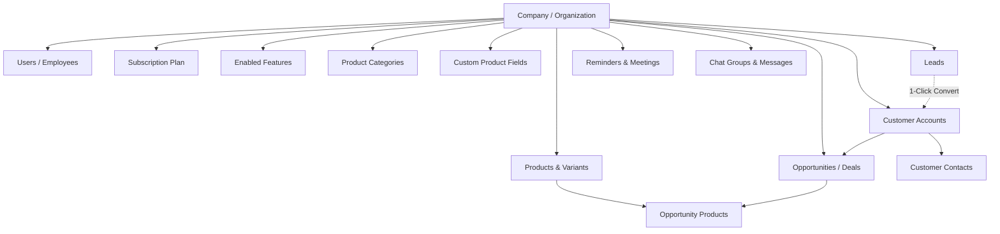
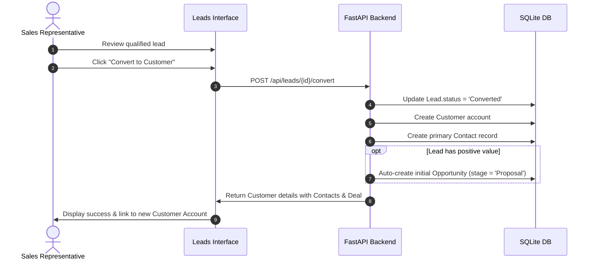
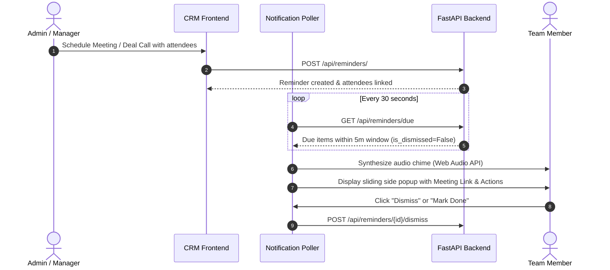

# 01 - Project Overview

## What is Enterprise CRM?

**Enterprise CRM** is a modern, full-stack, multi-tenant Customer Relationship Management (CRM) and Sales Intelligence platform. Designed as a flexible B2B Software-as-a-Service (SaaS) application, it empowers businesses to streamline lead tracking, sales pipeline management, customer account directories, dynamic multi-industry product catalogs, internal team collaboration, and automated meeting/task reminders.

The system is architected to support both **Platform Super-Administrators** (who oversee all tenant companies, subscription tiers, and feature toggles) and **Individual Tenant Organizations** (who manage their sales pipelines, teams, inventory, and client communications in strict data isolation).

---

## Why Does This Project Exist?

Traditional CRM platforms often suffer from two major extremes:
1. **Monolithic Complexity & Prohibitive Costs**: Tools like Salesforce or SAP are expensive, rigid, and over-engineered for fast-moving sales and service teams.
2. **Inflexible Static Data Models**: Typical lightweight open-source CRMs force every company into a fixed schema (e.g., standard "price" and "SKU" fields), failing to support diverse industries like fashion apparel (sizes, colors, fabrics), SaaS software (billing frequencies, seat counts, APIs), or manufacturing (dimensions, technical specs, tolerances).

**Enterprise CRM solves these challenges by combining:**
- **Dynamic Multi-Industry Product Engine**: Organizations can instantly adopt pre-configured product schemas from 12 industries (e.g., Clothing, SaaS, Sports, Electronics, Real Estate, Automotive) or create custom tenant-specific fields with multi-select, currency, and validation rules.
- **Strict Row-Level Multi-Tenancy**: Data from multiple companies resides in a unified database while remaining isolated through automated tenant security filtering.
- **Granular Role-Based Access Control (RBAC)**: An intuitive permission matrix allows organization administrators to assign granular view/create/edit/delete capabilities across all entities.
- **Built-in Collaboration & Scheduling**: A native meeting/reminder system with browser audio alerts, due-task side popups, and real-time internal group chats reduces reliance on fragmented third-party utilities.
- **Robust Data Onboarding**: Built-in CSV import tools with character encoding auto-detection (UTF-8, Windows CP1252, ISO-8859-1) allow sales teams to import existing lead and contact datasets within seconds.

---

## Core Domain Entities & Relationships

The CRM data model revolves around the following foundational entities:

### 1. Multi-Tenant Infrastructure
- **Company / Organization (`companies`)**: The tenant entity. Represents an independent business account (e.g., "Acme Tech Solutions", "Sam Inc") with a dedicated domain, industry classification, subscription status, and user capacity.
- **Subscription Plan (`subscription_plans`)**: Tier definitions (Trial, Basic, Professional, Enterprise) dictating user limits, pricing, and storage allowances.
- **Feature & OrganizationFeature (`features`, `organization_features`)**: Modular toggles enabling or disabling system functionality per tenant (e.g., `leads`, `contacts`, `products`, `inventory`, `reports`, `activities`, `warehouses`, `whatsapp`).

### 2. User & Access Management
- **User (`users`)**: Represents an authenticated person who can access the system. Users hold one of four roles: `super_admin`, `admin`, `manager`, or `employee`. Users belong to a specific company (except Super Admins) and can report to a manager.
- **User Permission (`user_permissions`)**: Granular overrides granted by Organization Admins to Managers or Employees for individual operations (e.g., `leads.create`, `contacts.delete`, `products.edit`).
- **User Activity Log (`user_activity_logs`)**: Audit log tracking logins, logouts, client IP addresses, user agents, and session timestamps.

### 3. Sales & Pipeline Lifecycle
- **Lead (`leads`)**: An unvetted prospective sales contact. Leads track deal potential value, status progression (`New` &rarr; `Contacted` &rarr; `Qualified` &rarr; `Converted` / `Lost`), assigned salespeople, notes, and company names.
- **Customer (`customers`)**: An active or qualified company account. Created manually or generated automatically upon lead conversion.
- **Contact (`contacts`)**: Individual persons associated with a Customer account, capturing full name, email, phone, job title, and primary contact status.
- **Opportunity (`opportunities`)**: A qualified deal tracked across six pipeline stages (`Prospecting` &rarr; `Qualification` &rarr; `Proposal` &rarr; `Negotiation` &rarr; `Closed Won` &rarr; `Closed Lost`).
- **Opportunity Product (`opportunity_products`)**: Association table linking products from the catalog to a specific deal with negotiated quantities and unit prices.

### 4. Dynamic Catalog & Inventory
- **Industry Template (`industry_templates`)**: System-wide industry blueprint (e.g., Software, Clothing, Real Estate) defining categories and dynamic custom fields.
- **Org Product Field (`org_product_fields`)**: Tenant-specific custom product attribute (e.g., "Fabric", "Storage Capacity", "License Type").
- **Product (`products`)**: Catalog entry representing physical goods, software subscriptions, or services.
- **Product Variant (`product_variants`)**: Sub-SKUs for products requiring size/color/tier variations (e.g., Size L, Red, 128GB).
- **Product Field Value (`product_field_values`)**: The entity-attribute-value storage holding concrete field values for each product.

### 5. Collaboration, Productivity & Reminders
- **Reminder (`reminders`)**: Scheduled meetings, daily tasks, deal calls, and reminders with priority ratings (`low`, `medium`, `high`, `urgent`), calendar timestamps, location, and meeting links.
- **Reminder Attendee (`reminder_attendees`)**: Organization members invited to a reminder, tracking invitation status (`invited`, `accepted`), read status, and side-popup dismissal status.
- **Chat Group (`chat_groups`) & Message (`chat_messages`)**: Internal organization chat channels for seamless team communication.
- **Import Job (`import_jobs`)**: Historical logs of bulk CSV data imports for leads and contacts.

---

## Primary Business Workflows

### 1. Lead Conversion Workflow

### 2. Meeting & Reminder Real-Time Alert Workflow

---

## System User Roles

| Role Key | Name | Scope & Authority |
| :--- | :--- | :--- |
| `super_admin` | Platform Super Administrator | Full cross-tenant administrative control. Can create organizations, manage global subscription tiers, toggle features per company, assign industry templates, and inspect system audit logs. |
| `admin` | Organization Administrator | Full control within their specific organization. Can invite team members, assign Manager/Employee roles, configure custom product fields and categories, create chat groups, and edit permissions. |
| `manager` | Sales / Team Manager | Leads a team of employees. Can view organization pipeline, manage direct subordinates, create meetings/tasks, and conduct sales activities. |
| `employee` | Sales Rep / Staff Member | Individual contributor. Can view and create assigned leads, track customer accounts, update deal stages, participate in group chats, and attend scheduled meetings. |
