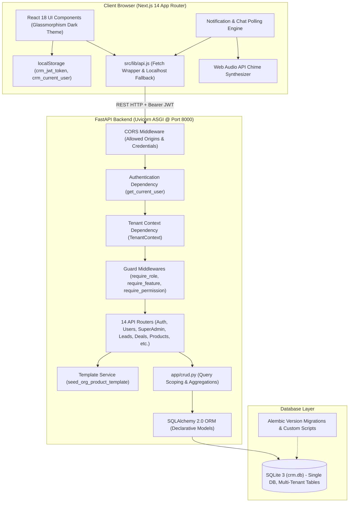
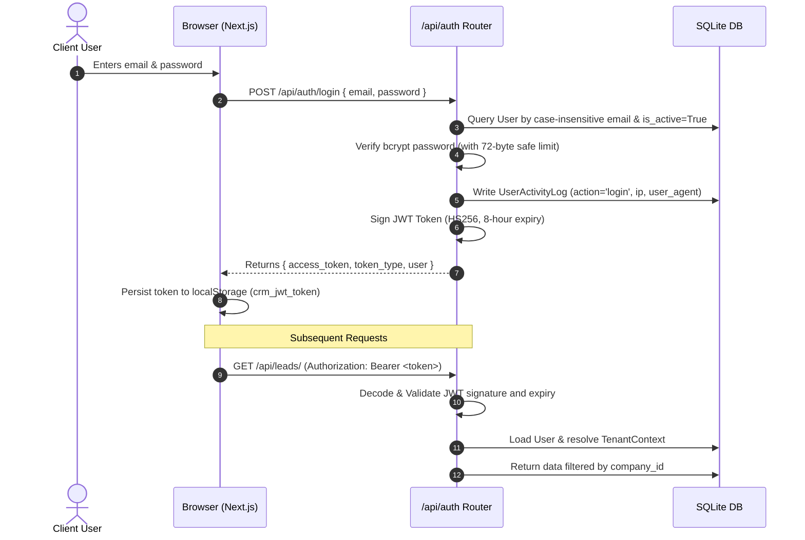

# 02 - System Architecture

This document provides a technical walkthrough of how the software components, security boundaries, and data pipelines interlock in the **Enterprise Multi-Tenant SaaS CRM**.

---

## High-Level Architecture Diagram



---

## 1. Multi-Tenant Architecture & Data Isolation

The application implements **Shared-Database, Shared-Schema Multi-Tenancy with Row-Level Isolation**:

1. **The Tenant Key (`company_id`)**:
   Every tenant-scoped table (`users`, `leads`, `customers`, `contacts`, `opportunities`, `products`, `org_product_fields`, `org_categories`, `reminders`, `chat_groups`, `import_jobs`, `user_activity_logs`) has a `company_id` column referencing `companies.id`.

2. **The `TenantContext` Security Boundary**:
   Every protected API router injects `TenantContext` via FastAPI's `Depends(get_tenant_context)`:
   ```python
   class TenantContext:
       def __init__(self, user: models.User):
           self.user = user
           self.user_id = user.id
           self.role = user.role
           self.organization_id = user.company_id
           self.is_super_admin = (user.role == models.UserRole.SUPER_ADMIN)
           self.is_admin = (user.role in [models.UserRole.SUPER_ADMIN, models.UserRole.ADMIN])
           self.is_manager = (user.role == models.UserRole.MANAGER)
           self.is_employee = (user.role == models.UserRole.EMPLOYEE)

       def filter_query(self, query, model):
           """Scopes any SQLAlchemy query strictly to tenant organization_id."""
           if self.is_super_admin:
               return query
           if hasattr(model, 'company_id'):
               return query.filter(model.company_id == self.organization_id)
           return query

       def enforce_ownership(self, entity):
           """Validates entity belongs to tenant organization; raises HTTP 404 if isolated."""
           if self.is_super_admin:
               return
           entity_org_id = getattr(entity, 'company_id', getattr(entity, 'organization_id', None))
           if entity_org_id != self.organization_id:
               raise HTTPException(status_code=404, detail="Resource not found or access denied")
   ```

3. **Super Admin Bypass**:
   Users with the `super_admin` role have cross-organization visibility, enabling platform-wide tenant management, template provisioning, and audit oversight.

---

## 2. Authentication & Authorization Lifecycle



### Security Details & Defensive Rules:
- **Bcrypt 72-Byte Boundary**: Passwords in `passlib` are UTF-8 truncated to 72 bytes before hashing to prevent denial-of-service / runtime exceptions caused by long inputs.
- **Graceful Password Fallback**: During local development and testing, legacy demo hash formats fall back cleanly without breaking existing seeded users.
- **JWT Expiration & Auto-Logout**: Access tokens expire after 8 hours. When an endpoint returns HTTP 401, `src/lib/api.js` clears `localStorage` and triggers a custom browser event `crm-auth-expired` that redirects the UI back to the login screen.

---

## 3. Server-Side Feature Toggles & Subscription Enforcement

Access to major functional modules is guarded by server-side dependencies:

```python
@router.get("/", response_model=List[schemas.LeadResponse])
def read_leads(
    db: Session = Depends(get_db),
    tenant: TenantContext = Depends(require_feature("leads"))
):
    ...
```

The `require_feature(code)` dependency enforces two layers:
1. **Subscription Status Check**: If the organization's account status is `SUSPENDED`, `CANCELLED`, `EXPIRED`, or `UNPAID`, access is blocked with HTTP 403.
2. **Feature Toggle Check**: Confirms that the specific module (e.g., `leads`, `products`, `contacts`) is enabled in `organization_features` for that company.

---

## 4. Frontend-to-Backend Network Resilience

The frontend API client ([`src/lib/api.js`](file:///d:/Projects/CRM/frontend/src/lib/api.js)) features built-in connection resiliency:

- **Localhost IPv6 vs. IPv4 Fallback**: If Windows DNS resolves `localhost:8000` to `::1` (IPv6) and fails to connect, the client automatically re-attempts the request against `127.0.0.1:8000` before surfacing an error to the user.
- **Port Normalization**: Automatically normalizes legacy port configuration values (e.g. converting erroneous port 8001 to 8000).
- **Multipart Upload Handling**: Dedicated `fetchUpload` method omits explicit `Content-Type` headers so the browser can calculate the correct multipart boundary for CSV file uploads.

---

## 5. Client-Side Polling Engines

Because the application is designed to run efficiently on standard hosting without requiring persistent WebSocket state servers, real-time updates use lightweight HTTP polling:

1. **Reminder & Notification Poller**:
   - Runs every 30 seconds inside `NotificationReminderCenter.js`.
   - Calls `GET /api/reminders/due`.
   - Compares items against locally dismissed IDs.
   - When a meeting or task enters the &plusmn;5 minute execution window, triggers the **Web Audio API** chime and displays a non-blocking glassmorphic side popup toast.

2. **Team Chat Poller**:
   - When an active chat group is open, polls `GET /api/chat/groups/{id}/messages` every 3 seconds to fetch incoming team messages.

3. **Active Users & Activity Log**:
   - The `/activity` page queries `/api/activity/online-users`, which computes users with successful login events within the last 24 hours.
