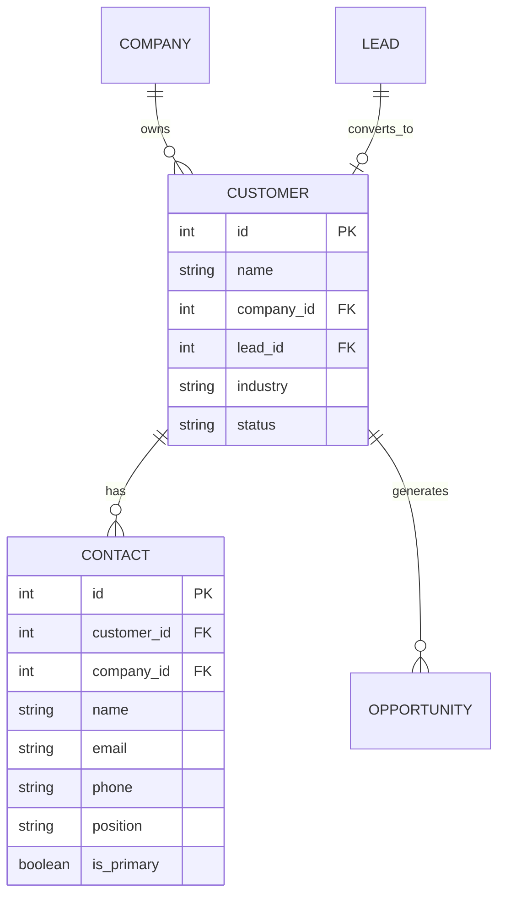

# Feature: Customer Accounts & Contact Directory

## Overview

The **Customer Accounts & Contact Directory** module tracks client company profiles, organizational stakeholders, point-of-contact details, and historical deal relationships. It guarantees structured account hierarchy where every contact belongs to a verified customer account.

---

## Data Model & Hierarchy

### Relational Rules & Unique Constraints:
1. **Customer Uniqueness**: Enforced via `UniqueConstraint('name', 'company_id')` to prevent duplicate account creation within an organization.
2. **Contact Uniqueness**: Enforced via `UniqueConstraint('email', 'customer_id')` ensuring a contact email appears only once under any specific customer account.
3. **Primary Contact**: A customer can designate one contact as `is_primary = True` for invoice routing and primary communications.

---

## Full Contact Detail Aggregation

To provide sales reps with comprehensive context without multiple network round-trips, the `/api/contacts/` endpoint executes an eager-loaded joined query (`get_contacts_with_full_details`):
- Fetches contact profile (`name`, `email`, `phone`, `position`, `is_primary`).
- Joins the parent `Customer` account and its parent `Company` domain and industry.
- Injects a summary list of all associated `Opportunities` (deal title, stage, value, and close date).

---

## Code & Router Mapping

- **Routers**:
  - [`backend/app/routers/customers.py`](file:///d:/Projects/CRM/backend/app/routers/customers.py):
    - `GET /api/customers/`: Lists customer accounts with embedded contacts and deals.
    - `POST /api/customers/`: Creates a customer company account.
    - `POST /api/customers/{id}/contacts`: Adds a contact directly to a customer account.
  - [`backend/app/routers/contacts.py`](file:///d:/Projects/CRM/backend/app/routers/contacts.py):
    - `GET /api/contacts/`: Returns all contacts with parent company and deal history.
- **Frontend Pages**:
  - [`frontend/src/app/customers/page.js`](file:///d:/Projects/CRM/frontend/src/app/customers/page.js): Customer directory with active deal value rollup and primary contact cards.
  - [`frontend/src/app/contacts/page.js`](file:///d:/Projects/CRM/frontend/src/app/contacts/page.js): Full contact table, quick email/call buttons, primary badges, customer filters, and CSV import modal.
