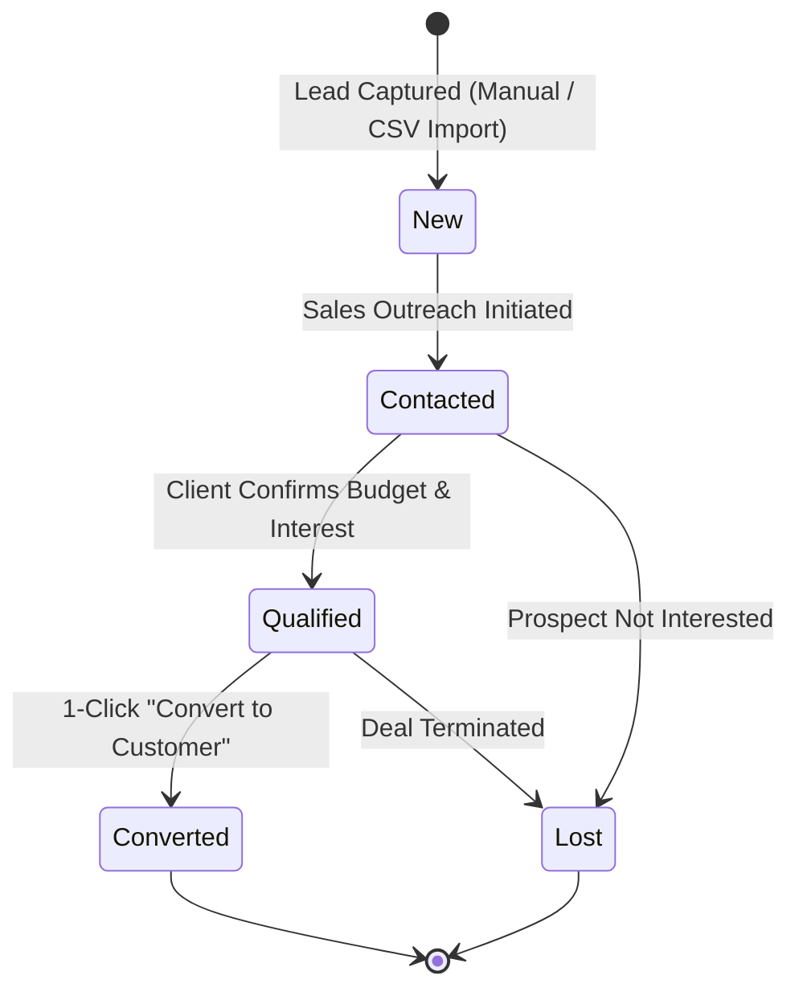

# Feature: Leads Management & 1-Click Conversion

## Overview

The **Leads Management** module allows sales organizations to capture, track, score, and convert prospective sales opportunities. It provides filtering by status, salesperson assignment, rich notes, and an automated 1-click conversion engine that turns a qualified lead into an active Customer account, Primary Contact, and Pipeline Deal in a single atomic transaction.

---

## Lead Lifecycle & Statuses

- **`New`**: Newly captured lead awaiting first contact.
- **`Contacted`**: Outreach initiated via phone, email, or meeting.
- **`Qualified`**: Decision-maker verified, budget aligned, requirements understood.
- **`Converted`**: Prospect successfully won and converted into customer records.
- **`Lost`**: Lead declined or disqualified.

---

## 1-Click Conversion Engine

When a salesperson clicks **Convert to Customer** on a qualified lead, the backend executes an atomic workflow ([`app/crud.py`](file:///d:/Projects/CRM/backend/app/crud.py#L82)):

1. **Status Update**: Marks the lead's status as `CONVERTED`.
2. **Customer Account Creation**:
   - Creates a new `Customer` record named after the lead's company name (or contact name if individual).
   - Links `lead_id` to establish audit provenance.
3. **Primary Contact Generation**:
   - Creates a new `Contact` linked to the customer.
   - Sets `is_primary = True`.
   - Populates name, email, and phone directly from lead contact info.
4. **Initial Pipeline Opportunity Creation**:
   - If `lead.value > 0`, automatically creates a new `Opportunity` titled `"Deal for [Customer Name]"` with stage `PROPOSAL` and the specified deal value.

---

## Code & Router Mapping

- **Router**: [`backend/app/routers/leads.py`](file:///d:/Projects/CRM/backend/app/routers/leads.py)
  - `GET /api/leads/`: Returns tenant-scoped leads with optional `status` filter and pagination.
  - `POST /api/leads/`: Creates a new lead assigned to a user or salesperson.
  - `PATCH /api/leads/{id}`: Updates lead status, notes, or contact info.
  - `POST /api/leads/{id}/convert`: Executes the conversion transaction and returns the resulting customer account.
- **Frontend Page**: [`frontend/src/app/leads/page.js`](file:///d:/Projects/CRM/frontend/src/app/leads/page.js)
  - Interactive table with quick status pills, search bar, lead creation modal, lead detail drawer, and CSV import trigger.
