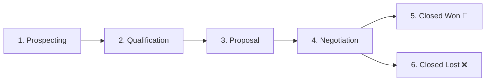

# Feature: Sales Pipeline & Opportunity Management

## Overview

The **Sales Pipeline & Opportunity Management** module gives revenue teams visibility over ongoing deals via an interactive Kanban board. It supports stage progressions, close date tracking, product catalog line-item associations, deal call scheduling, and automated revenue KPI aggregations.

---

## Pipeline Stages

1. **Prospecting**: Initial deal scoping and requirement gathering.
2. **Qualification**: Evaluation of economic buyer authority, timeline, and budget.
3. **Proposal**: Formal quote, pitch deck, or scope of work submitted to client.
4. **Negotiation**: Contract review, legal clauses, payment term discussions, and discounting.
5. **Closed Won**: Deal successfully signed and executed; counts toward realized revenue.
6. **Closed Lost**: Prospect chose competitor, deferred budget, or cancelled project.

---

## Line-Item Product Association

Opportunities can link directly to products in the company catalog via `opportunity_products`:
- Tracks `product_id`, `quantity`, and `unit_price`.
- Deals can calculate total value dynamically from the sum of associated products or allow customized override values negotiated by sales reps.

---

## Direct Action Triggers on Deal Cards

Within the Kanban interface, sales reps have immediate 1-click action triggers on any deal card:
- **Move Stage Buttons**: Instantly progress the deal to adjacent stages without entering complex sub-menus.
- **Schedule Deal Call**: Opens the **Notification & Reminder Center** modal pre-filled with the deal's title and customer ID, setting up a meeting or call reminder in seconds.
- **Edit Value & Target Close Date**: Quickly modify projections during weekly sales forecasting calls.

---

## Code & Router Mapping

- **Router**: [`backend/app/routers/opportunities.py`](file:///d:/Projects/CRM/backend/app/routers/opportunities.py)
  - `GET /api/opportunities/`: Lists opportunities with optional `stage` filter and 2,000 deal limit for high-volume boards.
  - `POST /api/opportunities/`: Creates an opportunity with optional line-item `product_ids`.
  - `PATCH /api/opportunities/{id}`: Updates stage, value, or expected close date.
- **Frontend Page**: [`frontend/src/app/opportunities/page.js`](file:///d:/Projects/CRM/frontend/src/app/opportunities/page.js)
  - 6-column glassmorphic Kanban board with deal count and column value totals, stage-move buttons, create deal modal with live product selector, and quick search.
