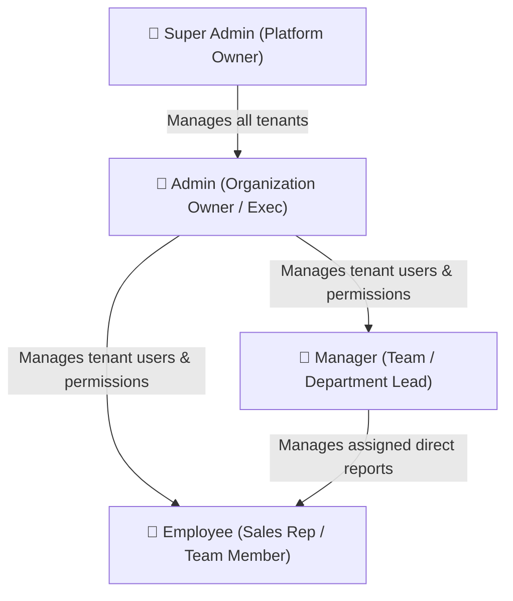

# Feature: Role-Based Access Control (RBAC) & Permissions

## Overview

The **RBAC & Permissions** module governs user authorization across the CRM. It combines a hierarchical four-tier role structure with an administrative **Granular Permission Matrix**, allowing organizations to tailor access privileges with pinpoint precision.

---

## The Four User Roles

| Role | Scope | Key Capabilities |
| :--- | :--- | :--- |
| **`super_admin`** | Entire Platform | Cross-tenant access; creates organizations; configures global subscription plans and system features; views platform activity logs. |
| **`admin`** | Single Organization | Full administrative control of company data; creates/deactivates users; grants granular permissions; manages industry product fields; creates team chat groups. |
| **`manager`** | Assigned Team | Manages direct subordinates (`manager_id`); creates employees reporting to self; assigns leads; schedules team meetings; views team pipeline. |
| **`employee`** | Personal Work | Creates and manages assigned leads; updates deal pipeline; accesses customer directory; attends scheduled meetings; participates in chat. |

---

## Granular Permission Matrix

In addition to standard role defaults, Organization Admins can grant or revoke specific granular privileges via the **Permissions Matrix** (`user_permissions` table):

| Category | Permission Key | Description |
| :--- | :--- | :--- |
| **Leads** | `leads.view` | View lead records in table and detail views |
| | `leads.create` | Create new leads via form or quick add |
| | `leads.edit` | Update lead status, values, notes, and assignments |
| | `leads.delete` | Delete lead records from the system |
| | `leads.convert` | Convert qualified leads into Customer accounts |
| **Contacts** | `contacts.view` | View directory of customer contacts |
| | `contacts.create` | Create new customer contacts |
| | `contacts.edit` | Modify contact information, titles, and phone numbers |
| | `contacts.delete` | Remove contact entries |
| **Customers** | `customers.view` | Browse customer company accounts |
| | `customers.create` | Create new customer company accounts |
| | `customers.edit` | Update customer company account details |
| **Opportunities** | `opportunities.view`| View sales pipeline deals |
| | `opportunities.create`| Create new sales opportunities |
| | `opportunities.edit`| Drag deals across Kanban stages or edit deal values |
| **Products** | `products.view` | View product catalog and variants |
| | `products.create` | Create new products, custom fields, and categories |
| | `products.edit` | Update product details, prices, and stock counts |
| | `products.delete` | Delete products or custom fields |
| **Reports** | `reports.view` | Access analytics dashboards and revenue reports |
| **Users** | `users.view` | View organization team member list |

> [!NOTE]
> Admins and SuperAdmins inherently bypass individual permission checks and possess all permissions by default.

---

## Role Escalation & Management Rules

To maintain security integrity, [`backend/app/routers/users.py`](file:///d:/Projects/CRM/backend/app/routers/users.py) enforces strict hierarchy rules:
- **Creation Guard**: A user can only create accounts with roles below their own (`_allowed_create_roles`).
- **Management Boundary**: Admins can manage Managers and Employees in their company, but cannot delete or demote fellow Admins or Super Admins (`_can_manage_target`).
- **Manager Boundary**: Managers can only manage Employees whose `manager_id` matches their own user ID.
- **Self-Preservation**: Users cannot delete or deactivate their own accounts.
- **Self-Edit Restriction**: Employees editing their own profile can only modify their `name` and `password`, preventing privilege escalation.

---

## Code & Router Mapping

- **Router**: [`backend/app/routers/permissions.py`](file:///d:/Projects/CRM/backend/app/routers/permissions.py)
  - `GET /api/permissions/available`: Lists all 21 permission definitions.
  - `GET /api/permissions/me`: Returns the logged-in user's granted permissions.
  - `GET /api/permissions/user/{id}`: Returns permissions for a specific user (Admin only).
  - `PUT /api/permissions/user/{id}`: Updates permissions array for a user (Admin only).
  - `GET /api/permissions/all-users`: Returns a map of all user permissions in the company.
- **Frontend Page**: [`frontend/src/app/users/page.js`](file:///d:/Projects/CRM/frontend/src/app/users/page.js)
  - Features an interactive **Permissions Matrix** modal where admins toggle checkmarks for any team member with 1-click bulk updates.
