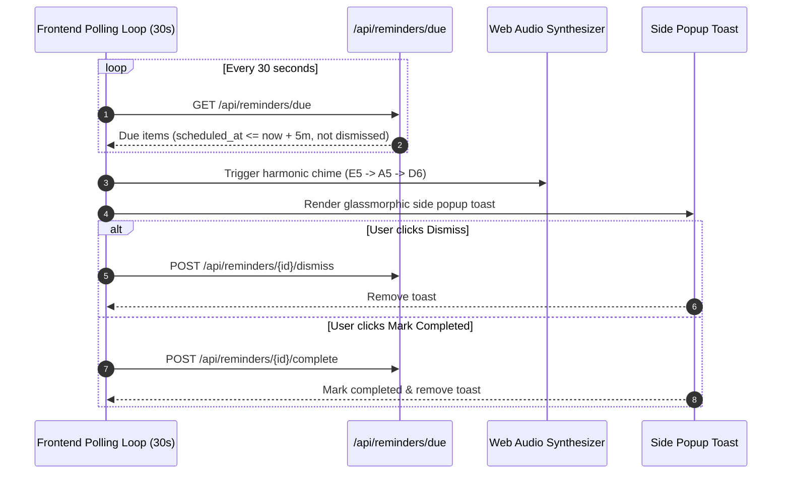

# Feature: Meetings, Tasks & Due Reminders

## Overview

The **Meetings, Tasks & Due Reminders** module provides calendar scheduling, daily to-do management, deal call follow-ups, and proactive client-side alerting. Featuring a persistent **Notification & Reminder Center** in the navigation header, it ensures sales reps and managers never miss a client appointment or task deadline.

---

## Reminder Types & Priorities

### Reminder Types:
- **`meeting`**: Internal team sync or external client video/in-person conference with meeting links and locations.
- **`task`**: Action items or daily to-dos assigned to self or team members.
- **`deal_call`**: Direct phone/virtual follow-up scheduled with a deal or customer contact.
- **`reminder`**: General calendar reminders.

### Priority Ratings:
- **`urgent`** (Crimson badge, high alert)
- **`high`** (Amber badge)
- **`medium`** (Default blue badge)
- **`low`** (Muted gray badge)

---

## Multi-Attendee Collaboration

When creating a meeting or reminder:
- The creator can invite colleagues from their organization via the `attendee_ids` parameter.
- The backend validates that all invited attendee IDs belong to the creator's company.
- The creator is automatically added as an attendee with `status = "accepted"` and `is_read = True`.
- Other attendees receive the reminder in their notifications with `status = "invited"`.

---

## Real-Time Due Alert & Audio Chime System

The notification system keeps users informed without requiring third-party push services:

### The Web Audio Synthesizer:
- Generated purely in-browser using `AudioContext`, requiring zero external MP3 assets.
- Plays an ascending sine harmonic sequence (659.25 Hz &rarr; 880.00 Hz &rarr; 1174.66 Hz) with exponential decay for a crisp, professional sound.

---

## Code & Router Mapping

- **Router**: [`backend/app/routers/reminders.py`](file:///d:/Projects/CRM/backend/app/routers/reminders.py)
  - `GET /api/reminders/`: Lists reminders with type, status, and scope (`today`, `upcoming`, `past`, `my_tasks`) filters.
  - `GET /api/reminders/due`: Returns active reminders due within 10 minutes that haven't been dismissed by current user.
  - `GET /api/reminders/today`: Returns agenda items scheduled for today.
  - `GET /api/reminders/organization-users`: Returns list of colleagues in the same company for scheduling invites.
  - `POST /api/reminders/`: Schedules new meeting or task with attendee invites.
  - `PATCH /api/reminders/{id}`: Modifies time, location, or attendee list.
  - `POST /api/reminders/{id}/dismiss`: Dismisses popup for current user.
  - `POST /api/reminders/{id}/complete`: Marks task or meeting as completed.
- **Frontend Component**: [`frontend/src/app/components/NotificationReminderCenter.js`](file:///d:/Projects/CRM/frontend/src/app/components/NotificationReminderCenter.js)
  - Bell icon with unread badge count, dropdown agenda drawer, side popup alert toasts, and full scheduling modal.
