# Database: Entity-Relationship Diagram (ERD)

The diagram below maps all entity relationships in the Enterprise CRM database.

---

## Complete Entity-Relationship Diagram

```mermaid
erDiagram
    COMPANIES ||--o{ USERS : employs
    COMPANIES ||--o{ LEADS : owns
    COMPANIES ||--o{ CUSTOMERS : owns
    COMPANIES ||--o{ PRODUCTS : owns
    COMPANIES ||--o{ ORG_PRODUCT_FIELDS : defines
    COMPANIES ||--o{ ORG_CATEGORIES : organizes
    COMPANIES ||--o{ REMINDERS : schedules
    COMPANIES ||--o{ CHAT_GROUPS : hosts
    COMPANIES ||--o{ IMPORT_JOBS : executes
    COMPANIES ||--o{ ORGANIZATION_SUBSCRIPTIONS : subscribes
    COMPANIES ||--o{ ORGANIZATION_FEATURES : activates

    SUBSCRIPTION_PLANS ||--o{ ORGANIZATION_SUBSCRIPTIONS : provides
    FEATURES ||--o{ ORGANIZATION_FEATURES : configures

    USERS ||--o{ USERS : manages
    USERS ||--o{ USER_PERMISSIONS : receives
    USERS ||--o{ USER_ACTIVITY_LOGS : generates
    USERS ||--o{ REMINDERS : creates
    USERS ||--o{ REMINDER_ATTENDEES : attends
    USERS ||--o{ CHAT_GROUP_MEMBERS : joins
    USERS ||--o{ CHAT_MESSAGES : writes

    LEADS ||--o| CUSTOMERS : converts_into
    LEADS }o--|| USERS : assigned_to

    CUSTOMERS ||--o{ CONTACTS : has
    CUSTOMERS ||--o{ OPPORTUNITIES : generates

    OPPORTUNITIES ||--o{ OPPORTUNITY_PRODUCTS : includes
    PRODUCTS ||--o{ OPPORTUNITY_PRODUCTS : linked_in

    PRODUCTS ||--o{ PRODUCT_VARIANTS : has_variants
    PRODUCTS ||--o{ PRODUCT_FIELD_VALUES : has_values
    PRODUCTS }o--o| ORG_CATEGORIES : categorized_in

    ORG_PRODUCT_FIELDS ||--o{ ORG_PRODUCT_FIELD_OPTIONS : has_options
    ORG_PRODUCT_FIELDS ||--o{ PRODUCT_FIELD_VALUES : defines_attribute

    ORG_CATEGORIES ||--o{ ORG_CATEGORIES : subcategories

    INDUSTRY_TEMPLATES ||--o{ TEMPLATE_FIELDS : templates_fields
    INDUSTRY_TEMPLATES ||--o{ TEMPLATE_CATEGORIES : templates_categories

    REMINDERS ||--o{ REMINDER_ATTENDEES : invites
    CHAT_GROUPS ||--o{ CHAT_GROUP_MEMBERS : includes
    CHAT_GROUPS ||--o{ CHAT_MESSAGES : contains

    COMPANIES {
        int id PK
        string name
        string domain UK
        string industry
        string status
        int owner_id FK
        int max_users
    }

    USERS {
        int id PK
        string name
        string email UK
        string password_hash
        string role
        int company_id FK
        int manager_id FK
        boolean is_active
    }

    LEADS {
        int id PK
        string title
        int company_id FK
        string company_name
        string contact_name
        string contact_email
        string status
        decimal value
        int assigned_user_id FK
    }

    CUSTOMERS {
        int id PK
        string name
        int company_id FK
        int lead_id FK
        string industry
        string status
    }

    CONTACTS {
        int id PK
        int customer_id FK
        int company_id FK
        string name
        string email
        boolean is_primary
    }

    OPPORTUNITIES {
        int id PK
        int customer_id FK
        int company_id FK
        string title
        decimal value
        string stage
        date close_date
    }

    PRODUCTS {
        int id PK
        int company_id FK
        int category_id FK
        string name
        string code
        decimal price
        decimal cost_price
        string product_type
        int stock_quantity
    }

    REMINDERS {
        int id PK
        int company_id FK
        int creator_id FK
        string title
        string reminder_type
        string priority
        string status
        datetime scheduled_at
    }

    CHAT_GROUPS {
        int id PK
        int company_id FK
        string name
        int created_by FK
    }
```

---

## Cardinality & Relationship Summary

| Parent Entity | Child Entity | Relationship Type | Cascade Deletion Behavior |
| :--- | :--- | :--- | :--- |
| **`companies`** | `users` | 1-to-Many | Cleared on company delete |
| **`companies`** | `leads` | 1-to-Many | Deleted on company delete |
| **`companies`** | `customers` | 1-to-Many | Deleted on company delete |
| **`companies`** | `products` | 1-to-Many | Deleted on company delete |
| **`companies`** | `org_product_fields` | 1-to-Many | Deleted on company delete |
| **`companies`** | `reminders` | 1-to-Many | Deleted on company delete |
| **`customers`** | `contacts` | 1-to-Many | `cascade="all, delete-orphan"` |
| **`customers`** | `opportunities` | 1-to-Many | `cascade="all, delete-orphan"` |
| **`opportunities`** | `opportunity_products` | 1-to-Many | `cascade="all, delete-orphan"` |
| **`products`** | `product_variants` | 1-to-Many | `cascade="all, delete-orphan"` |
| **`products`** | `product_field_values` | 1-to-Many | `cascade="all, delete-orphan"` |
| **`reminders`** | `reminder_attendees` | 1-to-Many | `cascade="all, delete-orphan"` |
| **`chat_groups`** | `chat_messages` | 1-to-Many | `cascade="all, delete-orphan"` |
| **`chat_groups`** | `chat_group_members` | 1-to-Many | `cascade="all, delete-orphan"` |
